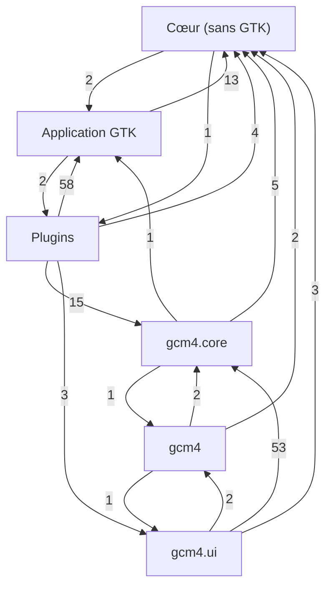
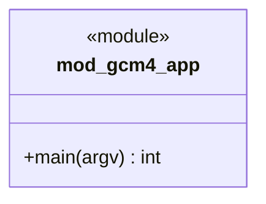

<!-- FICHIER GÉNÉRÉ par scripts/generate_class_diagram.py -- NE PAS ÉDITER À LA MAIN. -->

# GCM — diagramme de classes

> **Fichier généré depuis le code** par `scripts/generate_class_diagram.py` (issue #175) :
> toute modification manuelle sera écrasée. Le régénérer avec `make class-diagram` ;
> le job Qualité échoue s'il est périmé (`--check`).

95 modules · 165 classes · 317 fonctions publiques de module.

Conventions : `+` public, `-` privé (préfixe `_`) ; `list~str~` = `list[str]` ; `<<module>>`
regroupe les fonctions publiques d'un module ; `<<…>>` sur une classe liste `dataclass` et les
bases définies hors du bloc. Les méthodes privées et les classes imbriquées ne sont pas
représentées. Périmètre : racine, `plugins/` et `src/gcm4/` (hors tests, outils et sous-projets).

## Dépendances entre groupes

Nombre d'instructions `import` d'un groupe vers un autre. Le cœur n'importe ni GTK ni plugin
(`tests/test_architecture_imports.py`).

## Cœur (sans GTK)

| Module | Fichier | Rôle |
|---|---|---|
| `folder_context_menu_core` | `folder_context_menu_core.py` | Logique metier pure du menu contextuel du panneau de serveurs (zero import Gtk/Gio). |
| `gcm4_core` | `gcm4_core.py` | Logique métier de GNOME Connection Manager — zéro dépendance GTK. |
| `gesture_trigger_core` | `gesture_trigger_core.py` | Logique métier pure du déclenchement des menus contextuels (zéro import Gtk/Gio). |
| `inline_editor_core` | `inline_editor_core.py` | Logique métier pure de l'éditeur inline `CellTextView` (`widgets.py`, zéro import Gtk). |
| `logging_config` | `logging_config.py` | logging_config -- configuration centrale de loguru (issue #130, sous-issue 4a). |
| `master_password_core` | `master_password_core.py` | Protection par mot de passe maître du fichier de clé locale (``KEY_FILE``). |
| `netmiko_bulk_core` | `netmiko_bulk_core.py` | Cœur métier (sans GTK) du plugin de déploiement de configuration en masse via Netmiko pour GCM. |
| `popup_menu_core` | `popup_menu_core.py` | Logique metier pure du menu contextuel du terminal (zero import Gtk/Gio/Vte). |
| `putty_import_core` | `putty_import_core.py` | Cœur métier (sans GTK) de l'import de sessions PuTTY pour GCM. |
| `snmp_bulk_core` | `snmp_bulk_core.py` | Cœur métier (sans GTK) du déploiement SNMP pour GCM. |
| `tab_context_menu_core` | `tab_context_menu_core.py` | Logique metier pure du menu contextuel des onglets (zero import Gtk/Gio/Vte). |

```mermaid
classDiagram
    class mod_folder_context_menu_core {
        <<module>>
        +build_folder_context_menu_layout(click_target)
        +should_show_protocol_items(click_target)
        +flatten_action_names(sections)
    }
    class mod_gcm4_core {
        <<module>>
        +migrate_legacy_config_dir(old_dir, new_dir) bool
        +dep_install_hint(pkg_debian, pkg_fedora, pkg_arch) str
        +bindtextdomain(app_name, locale_dir) None
        +setup_app_logger(config_dir, debug)
        +get_username() str None
        +get_password() str
        +load_encryption_key(key_file) None
        +initialise_encyption_key(key_file) None
        +xor(pw, str1) list~str~
        +encrypt_old(passw, string) str
        +decrypt_old(passw, string) str
        +encrypt(passw, string) str
        +decrypt(passw, string, version) str
        +color_to_hex(rgba, diff) str
        +proto_default_port(proto, plugin_registry) str
        +all_default_ports(plugin_registry) set~str~
        +compute_zoom_size(current_size, delta, minimum, maximum) float
        +resolve_cluster_command(text) str
        +mask_cluster_command(text) str
        +resolve_auto_close_tab(host_override, global_default) int
        +workspace_hosts(groups) list
        +serialize_open_tabs(open_hosts) list
        +parse_open_tabs(raw) list
        +resolve_host_specs(specs, groups) list
        +serialize_group_colors(color_map) str
        +parse_group_colors(raw) dict
        +resolve_group_color(group, color_map, default) str
        +resolve_connection_hook_command(template, host_name, host_address, host_group, protocol) str None
        +resolve_theme_mode(raw_mode) str
    }
    class mod_gesture_trigger_core {
        <<module>>
        +classify_tree_servers_press(button, n_press)
        +classify_terminal_click(button, n_press, ctrl_pressed, paste_on_right_click)
        +classify_tab_label_click(button, n_press)
    }
    class mod_inline_editor_core {
        <<module>>
        +classify_editor_key_press(keyval, state, shift_mask, control_mask, return_keyval, kp_enter_keyval, escape_keyval)
        +classify_editor_button_press(n_press)
    }
    class mod_logging_config {
        <<module>>
        +level_from_env() str
        +is_debug_level(level) bool
        +app_log_path(config_dir) str
        +configure_logging(level, config_dir, log_file, force)
        +enable_debug(level, config_dir)
        +current_level() str
        +log_files() list~str~
        +is_debug_enabled() bool
        +extract_debug_flag(argv) tuple~bool, list~str~~
        +add_debug_argument(parser) None
        +apply_debug_argument(args, config_dir) None
        +get_logger(name)
        +summarize(value, name) str
        +mask_password(text) str
    }
    class mod_master_password_core {
        <<module>>
        +is_protected(key_file_content) bool
        +protect_key_file_content(raw_key, master_password) str
        +unlock_key_file_content(protected_content, master_password) str
        +rewrap_key_file_content(protected_content, old_master_password, new_master_password) str
        +remove_master_password_protection(protected_content, master_password) str
    }
    class InvalidMasterPasswordError {
        <<Exception>>
    }
    class CorruptedProtectedContentError {
        <<Exception>>
    }
    class mod_netmiko_bulk_core {
        <<module>>
        +iter_all_device_types() list~tuple~str, str, str~~
        +load_inventory(path) list~InventoryRow~
        +find_missing_variables(template_text, context) list~str~
        +render_template(template_text, context) str
        +scan_output_for_errors(output_text) list~str~
        +push_to_device(row, profile, rendered_config, save) PushResult
        +run_bulk_push(rows, profiles, template_text, log_dir, save, max_workers, on_row_start, on_row_done, cancel_event) list~PushResult~
        +summarize_results(results) dict
    }
    class DeviceProfile {
        <<dataclass>>
        +str name
        +str device_type
        +str vendor
        +str username
        +str password
        +str secret
        +int port
        +int timeout
        +str save_command
        +to_netmiko_kwargs(host) dict
    }
    class ProfileStore {
        +reload() None
        +get(name) DeviceProfile None
        +names() list~str~
        +all() list~DeviceProfile~
        +set(profile) None
        +delete(name) None
        +save() None
        +write_template(path)$ None
    }
    class netmiko_bulk_core_InventoryRow {
        <<dataclass>>
        +str ip
        +str profile_name
        +dict~str, str~ variables
        +int line_no
        +render_context() dict~str, str~
    }
    class netmiko_bulk_core_PushResult {
        <<dataclass>>
        +InventoryRow row
        +str status
        +str output
        +str error
        +list~str~ config_errors
        +str log_path
        +float duration_s
        +ok() bool
    }
    class PushResultLike {
        <<Protocol>>
        +InventoryRow row
        +str status
        +str output
        +str error
        +list~str~ config_errors
        +str log_path
        +float duration_s
    }
    class mod_popup_menu_core {
        <<module>>
        +compute_enabled_actions(has_selection, multi_pane, has_split_notebook)
        +select_command_shortcuts(shortcuts)
        +format_command_label(shortcut, command, max_command_length)
        +flatten_action_names(sections)
    }
    class mod_putty_import_core {
        <<module>>
        +decode_putty_session_name(raw_filename) str
        +parse_putty_session_file(path) dict~str, str~
        +putty_session_to_row(session_name, raw) tuple~dict~str, str~ None, str None~
        +scan_putty_sessions(directory) tuple~list~dict~str, str~~, list~str~~
    }
    class mod_snmp_bulk_core {
        <<module>>
        +load_inventory(csv_path) list~InventoryRow~
        +find_missing_variables(template, available) set~str~
        +render_template(template, variables) str
        +upload_config_file(cfg, filename, content) str
        +push_to_device(row, profile, rendered_config, log_dir, server_ip, transfer) PushResult
        +run_bulk_push(rows, profiles, template_text, log_dir, max_workers, on_row_start, on_row_done, cancel_event, server_ip, transfer) list~PushResult~
        +summarize_results(results) dict~str, int~
    }
    class SnmpAuth {
        <<dataclass>>
        +str version
        +str community
        +str None username
        +str None auth_password
        +str auth_protocol
        +str None priv_password
        +str priv_protocol
        +str security_level
        +session_kwargs(host, port, timeout, retries) dict
    }
    class SnmpProfile {
        <<dataclass>>
        +str name
        +str vendor
        +SnmpAuth auth
        +int port
        +int timeout
        +int retries
        +float poll_interval
        +float poll_timeout
    }
    class SnmpProfileStore {
        +load() None
        +save() None
        +get(name) SnmpProfile None
        +all() list~SnmpProfile~
        +set(name, profile) None
        +delete(name) None
    }
    class snmp_bulk_core_InventoryRow {
        <<dataclass>>
        +int line_no
        +str ip
        +str profile_name
        +dict~str, str~ variables
    }
    class snmp_bulk_core_PushResult {
        <<dataclass>>
        +InventoryRow row
        +str status
        +str error
        +str log_path
        +float duration_s
    }
    class TransferError {
        <<RuntimeError>>
    }
    class FileTransferConfig {
        <<dataclass>>
        +str protocol
        +str host
        +int port
        +str username
        +str password
        +str remote_dir
        +str fetch_protocol
        +str fetch_path
        +str known_hosts
        +effective_port() int
        +effective_fetch_protocol() str
        +remote_path(filename) str
        +device_filename(filename) str
    }
    class SnmpDriver {
        +str vendor_id
        +str display_name
        +dict~str, int~ FETCH_PROTOCOLS
        +push(host, server_ip, filename, username, password, protocol) tuple~bool, str~
        +protocol_value(protocol) int None
    }
    class H3cComwareDriver {
        +push(host, server_ip, filename, username, password, protocol) tuple~bool, str~
    }
    SnmpDriver <|-- H3cComwareDriver
    class CiscoConfigCopyDriver {
        +push(host, server_ip, filename, username, password, protocol) tuple~bool, str~
    }
    SnmpDriver <|-- CiscoConfigCopyDriver
    class HuaweiVrpDriver {
        +push(host, server_ip, filename, username, password, protocol) tuple~bool, str~
    }
    SnmpDriver <|-- HuaweiVrpDriver
    class mod_tab_context_menu_core {
        <<module>>
        +build_tab_context_menu_layout(is_active, multi_pane)
        +flatten_action_names(sections)
    }
```

## Application GTK

| Module | Fichier | Rôle |
|---|---|---|
| `gnome_connection_manager` | `gnome_connection_manager.py` | GNOME Connection Manager - Terminal-based SSH/RDP/VNC/SPICE client manager. |
| `hypervisor_import_common` | `hypervisor_import_common.py` | Helpers partagés par les imports hyperviseurs (libvirt / Proxmox). |
| `key_picker_dialog` | `key_picker_dialog.py` | Dialogue de sélection de clé SSH existante depuis ~/.ssh/. |
| `models` | `models.py` | Modèles de données pour les hôtes et utilitaires de configuration. |
| `pyAES` | `pyAES.py` | AES encryption/decryption implementation in pure Python. |
| `ssh_config_editor` | `ssh_config_editor.py` | Dialogue GTK3 d'édition de ~/.ssh/config intégré à GCM. |
| `ssh_key_manager_dialog` | `ssh_key_manager_dialog.py` | Gestionnaire de clés SSH : liste, génération, import, suppression, copie. |
| `urlregex` | `urlregex.py` | Expressions régulières PCRE2 utilisées par GCM pour la détection d'URLs. |
| `utils` | `utils.py` | Utilitaires généraux et classe de base GTK pour l'application GCM. |
| `widgets` | `widgets.py` | Widgets GTK personnalisés pour l'interface GCM. |

```mermaid
classDiagram
    class mod_gnome_connection_manager {
        <<module>>
        +bindtextdomain(app_name, locale_dir)
        +msgbox(text, parent)
        +msgconfirm(text)
        +send_desktop_notification(summary, body)
        +run_pre_connect_hook(host)
        +resolve_post_connect_command(host, proto)
        +msginfo(text)
        +inputbox(title, text, default, password)
        +show_font_dialog(parent, title, button)
        +parse_color_rgba(spec)
        +parse_color(spec)
        +set_widget_font(widget, font_desc)
        +color_to_hex(rgba, diff)
        +get_key_name(event)
        +get_username()
        +get_password()
        +load_encryption_key()
        +initialise_encyption_key()
        +xor(pw, str1)
        +encrypt_old(passw, string)
        +decrypt_old(passw, string)
        +encrypt(passw, string)
        +decrypt(passw, string)
        +vte_feed(terminal, data)
        +get_serial_templates()
        +set_serial_templates(templates)
        +reset_serial_templates()
        +main()
    }
    class SerialTemplatesTab {
        +apply()
    }
    class Wmain {
        <<Gtk.Window>>
        +get_widget(name)
        +update_visual()
        +enable_window_transparency(window)
        +new()
        +check_updates()
        +attach_terminal_click_gesture(widget)
        +on_terminal_pressed(gesture, n_press, x, y, widget)
        +on_terminal_keypress(widget, event, *args)
        +terminal_zoom(widget, delta, reset)
        +on_terminal_selection(widget, *args)
        +find_word(backwards)
        +init_search()
        +chunkstring(string, length)
        +on_popupmenu(widget, item, *args)
        +createMenu()
        +on_mnu_export_csv_activate(widget, *args)
        +on_mnu_export_json_activate(widget, *args)
        +on_mnu_dark_mode_toggled(widget, *args)
        +terminal_copy(terminal)
        +terminal_paste(terminal)
        +terminal_copy_paste(terminal)
        +terminal_select_all(terminal)
        +terminal_copy_all(terminal)
        +on_menuCopy_activate(widget)
        +on_menuPaste_activate(widget)
        +on_menuCopyPaste_activate(widget)
        +on_menuSelectAll_activate(widget)
        +on_menuCopyAll_activate(widget)
        +on_menuSettings_activate(widget)
        +on_output_written(terminal, data)
        +on_contents_changed(terminal)
        +set_terminal_logger(terminal, enable_logging, continuous_mode)
        +registerUrlRegexes(terminal)
        +registerUrlRegex(terminal, regex)
        +open_management_tab(key, title, factory)
        +close_management_tab(tab_key)
        +addTab(notebook, host)
        +send_data(terminal, data)
        +initLeftPane()
        +on_treeServers_tooltip(widget, x, y, keyboard, tooltip)
        +add_shortcut(cp, scuts, command, name, default)
        +loadConfig()
        +is_node_collapsed(model, path, iter, nodes)
        +get_collapsed_nodes()
        +set_collapsed_nodes()
        +servers_background_color()
        +updateTree()
        +update_row_color(node)
        +get_folder(obj, folder, path)
        +writeConfig()
        +on_tab_scroll(notebook, event)
        +on_tab_focus(widget, tab, *args)
        +split_notebook(direction)
        +find_notebook(widget, exclude)
        +find_active_terminal(widget)
        +check_notebook_pages(widget)
        +on_page_removed(widget, *args)
        +on_page_added(widget, *args)
        +show_save_buffer(terminal)
        +set_panel_visible(visibility)
        +on_wMain_destroy(widget, *args)
        +on_wMain_delete_event(widget, *args)
        +on_guardar_como1_activate(widget, *args)
        +on_importar_servidores1_activate(widget, *args)
        +on_exportar_servidores1_activate(widget, *args)
        +on_salir1_activate(widget, *args)
        +on_show_panel_toggled(widget, *args)
        +on_acerca_de1_activate(widget, *args)
        +on_double_click(widget, event, *args)
        +on_btnLocal_clicked(widget, *args)
        +on_btnConnect_clicked(widget, *args)
        +on_btnAdd_clicked(widget, *args)
        +get_group(i)
        +on_bntEdit_clicked(widget, *args)
        +on_btnDel_clicked(widget, *args)
        +on_btnHSplit_clicked(widget, *args)
        +on_btnVSplit_clicked(widget, *args)
        +on_btnUnsplit_clicked(widget, *args)
        +on_btnConfig_clicked(widget, *args)
        +on_btnSearchBack_clicked(widget, *args)
        +on_btnSearch_clicked(widget, *args)
        +on_btnSearch_key_press(widget, event, *args)
        +on_btnCluster_clicked(widget, *args)
        +on_open_workspace_clicked(widget, *args)
        +on_hpMain_button_press_event(widget, event, *args)
        +on_tvServers_row_activated(widget, *args)
        +on_tvServers_row_collapsed(widget, *args)
        +on_tvServers_row_expanded(widget, *args)
        +on_tvServers_style_updated(widget, *args)
        +on_tvServers_pressed(gesture, n_press, x, y)
    }
    GCMBase <|-- Wmain
    class Whost {
        <<Gtk.Dialog>>
        +get_widget(name)
        +new()
        +init(group, host)
        +update_texttags(*args)
        +on_cancelbutton1_clicked(widget, *args)
        +on_okbutton1_clicked(widget, *args)
        +on_cmbType_changed(widget, *args)
        +on_chkCommands_toggled(widget, *args)
        +on_btnBColor_clicked(widget, *args)
        +on_chkDefaultColors_toggled(widget, *args)
        +on_btnFColor_clicked(widget, *args)
        +on_btnBrowse_clicked(widget, *args)
        +on_btnPickKey_clicked(widget, *args)
        +on_btnKeyManager_clicked(widget, *args)
    }
    GCMBase <|-- Whost
    class Wabout {
        <<Gtk.AboutDialog>>
        +on_wAbout_close(widget, *args)
    }
    GCMBase <|-- Wabout
    class Wconfig {
        <<Gtk.Dialog>>
        +new()
        +addParam(name, field, ptype, *args)
        +on_edited(widget, rownum, value, model, colnum)
        +on_editing_started(widget, entry, rownum, model, colnum)
        +on_cancelbutton1_clicked(widget, *args)
        +on_okbutton1_clicked(widget, *args)
        +on_btnBColor_clicked(widget, *args)
        +on_btnFColor_clicked(widget, *args)
        +on_chkDefaultColors_toggled(widget, *args)
        +on_chkDefaultFont_toggled(widget, *args)
        +on_btnFont_clicked(widget, *args)
        +on_treeCommands_key_press_event(widget, event, *args)
    }
    GCMBase <|-- Wconfig
    class Wcluster {
        <<Gtk.Dialog>>
        +new()
        +on_active_toggled(widget, path)
        +change_color(term, activate)
        +on_wCluster_destroy(widget, *args)
        +on_tab_will_close()
        +on_cancelbutton2_clicked(widget, *args)
        +on_btnAll_clicked(widget, *args)
        +on_btnNone_clicked(widget, *args)
        +on_btnInvert_clicked(widget, *args)
        +send_cluster_commands(widget)
        +on_txtCommands_key_press_event(widget, event, *args)
        +on_btnExecuteCluster_clicked(widget, *args)
    }
    GCMBase <|-- Wcluster
    class CheckUpdates {
        <<Thread>>
        +msg(text, parent)
        +on_clicked(*args)
        +run()
    }
    class mod_hypervisor_import_common {
        <<module>>
        +dep_install_hint(pkg_debian, pkg_fedora, pkg_arch)
        +vm_name_split(vm_name)
        +collect_ssh_keys()
        +paramiko_connect(hostname, port, username, log_fn)
        +libvirt_get_uris_from_dconf()
        +libvirt_ssh_run(client, cmd, timeout)
        +libvirt_nmap_scan(client, run_fn, log_fn)
        +check_port_open(client, run_fn, ip, port, timeout)
    }
    class KeyPickerDialog {
        <<Gtk.Dialog>>
        -dict __gsignals__
    }
    class models_Host {
        +tunnel_as_string()
        +clone()
    }
    class HostUtils {
        +get_val(cp, section, name, default)$
        +load_host_from_ini(cp, section, pwd)$
        +save_host_to_ini(cp, section, host, pwd)$
    }
    class mod_pyAES {
        <<module>>
        +rotate(word, n)
        +shiftRows(state)
        +shiftRowsInv(state)
        +keyScheduleCore(word, i)
        +expandKey(cipherKey)
        +subBytes(state)
        +subBytesInv(state)
        +addRoundKey(state, roundKey)
        +galoisMult(a, b)
        +mixColumn(column)
        +mixColumnInv(column)
        +mixColumns(state)
        +mixColumnsInv(state)
        +aesRound(state, roundKey)
        +aesRoundInv(state, roundKey)
        +createRoundKey(expandedKey, n)
        +passwordToKey(password)
        +aesMain(state, expandedKey, numRounds)
        +aesMainInv(state, expandedKey, numRounds)
        +aesEncrypt(plaintext, key)
        +aesDecrypt(ciphertext, key)
        +getBlock(fp)
        +encrypt(text, password)
        +decrypt(text, password)
    }
    class SshConfigEditorDialog {
        <<Gtk.Dialog>>
        +save() None
    }
    GCMBase <|-- SshConfigEditorDialog
    class _SshTestDialog {
        <<Gtk.Dialog>>
    }
    class mod_ssh_key_manager_dialog {
        <<module>>
        +get_default_ssh_key_comment() str
    }
    class SSHTargetSpec {
        <<dataclass>>
        +str user
        +str host
        +int port
        +display() str
        +ssh_base_cmd() list~str~
    }
    class _FSAdapter {
        +is_remote() bool
        +label() str
        +target_user() str
        +read_text(filename) str None
        +write_text(filename, content, mode) bool
        +test_connection() tuple~bool, str~
    }
    class _LocalFS {
        +is_remote() bool
        +label() str
        +target_user() str
        +read_text(filename) str None
        +write_text(filename, content, mode) bool
    }
    _FSAdapter <|-- _LocalFS
    class _RemoteFS {
        +is_remote() bool
        +label() str
        +target_user() str
        +read_text(filename) str None
        +write_text(filename, content, mode) bool
        +test_connection() tuple~bool, str~
    }
    _FSAdapter <|-- _RemoteFS
    class _GenerateKeyDialog {
        <<Gtk.Dialog>>
        +get_options() dict~str, str int bool~
    }
    class _AddAuthorizedKeyDialog {
        <<Gtk.Dialog>>
        +get_key_line() str
    }
    class _TestKnownHostsDialog {
        <<Gtk.Dialog>>
    }
    class _RenameKeyDialog {
        <<Gtk.Dialog>>
        +get_new_name() str
    }
    class _ChangePassphraseDialog {
        <<Gtk.Dialog>>
        +get_values() tuple~str, str, str~
    }
    class _ViewPublicKeyDialog {
        <<Gtk.Dialog>>
    }
    class SSHKeyManagerDialog {
        <<Gtk.Window>>
        +has_designated_ca() bool
    }
    GCMBase <|-- SSHKeyManagerDialog
    class mod_utils {
        <<module>>
        +run_dialog_sync(dialog) Gtk.ResponseType
        +show_open_dialog(parent, title, action, last_path_holder)
        +msgbox(text, parent, icon_path)
        +embed_dialog_content(gcm_instance)
    }
    class GCMBase {
        +request_close()
        +on_tab_will_close()
        +new()
        +run()
    }
    class conf
    class mod_widgets {
        <<module>>
        +build_remote_desktop_context_menu(btn_connect, btn_disconnect, send_special_keys_fn, extra_items)
        +mount_iso_temp(iso_path)
        +umount_iso_temp(loop_device)
        +vte_run(terminal, command, arg, extra_env)
        +inputbox(title, text, default, password, parent, icon_path)
    }
    class ManagementTabLabel {
        <<Gtk.Box>>
        +get_text()
    }
    class _LogActionShim {
        +get_active()
        +set_active(value)
    }
    class TabContextMenu {
        +rebuild(is_active, multi_pane, log_active)
        +popup_at(relative_to, x, y)
    }
    class FolderContextMenu {
        +rebuild(click_target)
        +popup_at(relative_to, x, y)
    }
    class PopupMenu {
        +rebuild(has_selection, multi_pane, has_split_notebook, log_active)
        +populate_commands(commands)
        +popup_at(relative_to, x, y)
        +popup_commands_at(relative_to)
    }
    class NotebookTabLabel {
        <<Gtk.Box>>
        +set_selected(sel)
        +on_close_tab(widget, notebook, *args)
        +close_tab(widget)
        +mark_tab_as_closed()
        +effective_auto_close_tab()
        +mark_tab_as_active()
        +get_text()
        +on_label_pressed(gesture, n_press, x, y)
    }
    class EntryDialog {
        <<Gtk.Dialog>>
        +quit(w, event)
        +click(button)
    }
    class CellTextView {
        <<Gtk.TextView, Gtk.CellEditable>>
        +do_editing_done(*args)
        +do_remove_widget(*args)
        +do_start_editing(*args)
        +get_text()
        +set_text(text)
    }
    class MultilineCellRenderer {
        <<Gtk.CellRendererText>>
        +do_start_editing(event, widget, path, bg_area, cell_area, flags)
    }
```

## Plugins

| Module | Fichier | Rôle |
|---|---|---|
| `plugins.local.core` | `plugins/local/core.py` | Logique du plugin local, sans GTK : shell à lancer et délai des commandes. |
| `plugins.local.gtk4` | `plugins/local/gtk4.py` | Plugin local de gcm4 (contrat v1, ``docs/plugins.md``) : shell local dans un terminal VTE GTK4. |
| `plugins.plugin_base` | `plugins/plugin_base.py` | Contrats plugin pour GCM. |
| `plugins.plugin_export_csv` | `plugins/plugin_export_csv.py` | Outil « Export to CSV » (BatchPlugin) pour GCM. |
| `plugins.plugin_export_json` | `plugins/plugin_export_json.py` | Outil « Export to JSON » (BatchPlugin) pour GCM. |
| `plugins.plugin_import_csv` | `plugins/plugin_import_csv.py` | Outil « Import from CSV » (BatchPlugin) pour GCM. |
| `plugins.plugin_import_json` | `plugins/plugin_import_json.py` | Outil « Import from JSON » (BatchPlugin) pour GCM. |
| `plugins.plugin_import_libvirt` | `plugins/plugin_import_libvirt.py` | Outil « Import from libvirt » (BatchPlugin) pour GCM. |
| `plugins.plugin_import_ovirt` | `plugins/plugin_import_ovirt.py` | Outil « Import from oVirt » (BatchPlugin) pour GCM. |
| `plugins.plugin_import_proxmox` | `plugins/plugin_import_proxmox.py` | Outil « Import from Proxmox » (BatchPlugin) pour GCM. |
| `plugins.plugin_import_putty` | `plugins/plugin_import_putty.py` | Outil « Import from PuTTY sessions » (BatchPlugin) pour GCM. |
| `plugins.plugin_import_virtualbox` | `plugins/plugin_import_virtualbox.py` | Outil « Import from VirtualBox » (BatchPlugin) pour GCM. |
| `plugins.plugin_ipmisol` | `plugins/plugin_ipmisol.py` | Plugin de connexion IPMI Serial-over-LAN (console BMC : iLO, iDRAC, IMM…). |
| `plugins.plugin_local` | `plugins/plugin_local.py` | Plugin de connexion "Local" (shell local, sans hôte distant). |
| `plugins.plugin_netmiko_push` | `plugins/plugin_netmiko_push.py` | Onglet « Netmiko » (déploiement de configuration en masse) pour GCM. |
| `plugins.plugin_rdp` | `plugins/plugin_rdp.py` | Plugin de connexion RDP (GtkFrdp.Display embarqué). |
| `plugins.plugin_serial` | `plugins/plugin_serial.py` | Plugin de connexion série (port local via picocom/minicom/screen). |
| `plugins.plugin_snmp_push` | `plugins/plugin_snmp_push.py` | Onglet « Push SNMP » (déploiement de configuration en masse par SNMP) pour GCM. |
| `plugins.plugin_spice` | `plugins/plugin_spice.py` | Plugin de connexion SPICE (SpiceClientGtk.Display natif, ou fallback subprocess). |
| `plugins.plugin_ssh` | `plugins/plugin_ssh.py` | Plugin de connexion SSH. |
| `plugins.plugin_telnet` | `plugins/plugin_telnet.py` | Plugin de connexion Telnet. |
| `plugins.plugin_vnc` | `plugins/plugin_vnc.py` | Plugin de connexion VNC (GtkVnc.Display natif, ou fallback subprocess). |
| `plugins.plugin_web` | `plugins/plugin_web.py` | Plugin de connexion Web (console BMC HTML5 : iLO/iDRAC/IMM, ou toute URL). |
| `plugins.pluginvnc2.vnc_tab` | `plugins/pluginvnc2/vnc_tab.py` | vnc_tab.py — Onglet VNC complet pour gnome-connection-manager (fork GTK4) |
| `plugins.sftp.core` | `plugins/sftp/core.py` | Logique du plugin SFTP (#75), sans GTK : connexion, navigation, transferts. |
| `plugins.sftp.gtk4` | `plugins/sftp/gtk4.py` | Plugin SFTP de gcm4 (contrat v1, ``docs/plugins.md``) : navigateur de fichiers distant (#75). |
| `plugins.ssh` | `plugins/ssh/__init__.py` | Plugin SSH — dossier pilote de la migration GTK4 (découpage par plugin). |
| `plugins.ssh.core` | `plugins/ssh/core.py` | Logique métier SSH de gcm4, zéro dépendance GTK — parsing de ``~/.ssh/config`` et migration/import des hôtes SSH de gcm.conf. |
| `plugins.telnet.core` | `plugins/telnet/core.py` | Logique du plugin telnet, sans GTK : commande et délai des commandes après connexion. |
| `plugins.telnet.gtk4` | `plugins/telnet/gtk4.py` | Plugin telnet de gcm4 (contrat v1, ``docs/plugins.md``) : terminal VTE GTK4. |

```mermaid
classDiagram
    class mod_plugins_local_core {
        <<module>>
        +shell(environ) str
        +lancement(chemin) Lancement
        +etapes(commandes) list~tuple~int, str~~
    }
    class LocalSession {
        <<SessionTerminal>>
    }
    class plugins_local_gtk4_LocalPlugin {
        +default_port(protocol) int None
        +build_host_options_widget(host, options, changed) Gtk.Widget
        +open(host) LocalSession
    }
    plugins_plugin_base_ConnectionPlugin <|-- plugins_local_gtk4_LocalPlugin
    class plugins_plugin_base_ConnectionPlugin {
        <<ABC>>
        +str protocol_id
        +str display_name
        +int None default_port
        +str icon_name
        +int ui_order
        +bool is_terminal
        +bool self_scrolling
        +object None app
        +build_tab(host, get_password) Gtk.Widget
        +build_edit_page() Gtk.Widget
        +load_host_fields(host) None
        +save_host_fields(host) None
        +host_fields() list~tuple~str, object~~
        +build_folder_context_menu_items() list~tuple~str, Callable~~~, None~~~
        +validate() list~str~
        +menu_actions() list
        +patch_edit_host_dialog(builder, host_section, cp) None
    }
    class plugins_plugin_base_PluginRegistry {
        +register(plugin) None
        +get(protocol_id) ConnectionPlugin None
        +all() list~ConnectionPlugin~
        +all_sorted() list~ConnectionPlugin~
        +bind_app(app) None
        +protocol_ids() list~str~
        +all_host_fields() list~tuple~str, object~~
        +autoload(directory, package) list~str~
    }
    class BatchPlugin {
        <<ABC>>
        +str tool_id
        +str display_name
        +str icon_name
        +str menu_section
        +object None app
        +activate() None
    }
    class BatchPluginRegistry {
        +register(plugin) None
        +get(tool_id) BatchPlugin None
        +all() list~BatchPlugin~
        +bind_app(app) None
        +tool_ids() list~str~
        +autoload(directory, package) list~str~
    }
    class mod_plugins_plugin_export_csv {
        <<module>>
        +get_batch_plugin() CsvExportBatchPlugin
    }
    class CsvExportBatchPlugin {
        +activate() None
    }
    BatchPlugin <|-- CsvExportBatchPlugin
    class mod_plugins_plugin_export_json {
        <<module>>
        +get_batch_plugin() JsonExportBatchPlugin
    }
    class JsonExportBatchPlugin {
        +activate() None
    }
    BatchPlugin <|-- JsonExportBatchPlugin
    class mod_plugins_plugin_import_csv {
        <<module>>
        +get_batch_plugin() CsvImportBatchPlugin
    }
    class CsvImportBatchPlugin {
        +activate() None
    }
    BatchPlugin <|-- CsvImportBatchPlugin
    class mod_plugins_plugin_import_json {
        <<module>>
        +get_batch_plugin() JsonImportBatchPlugin
    }
    class JsonImportBatchPlugin {
        +activate() None
    }
    BatchPlugin <|-- JsonImportBatchPlugin
    class mod_plugins_plugin_import_libvirt {
        <<module>>
        +build_preferences_tab(notebook)
        +get_batch_plugin() LibvirtImportBatchPlugin
    }
    class LibvirtPrefsTab {
        +apply()
    }
    class LibvirtImportDialog {
        <<GCMBase>>
    }
    class LibvirtImportBatchPlugin {
        +activate() None
    }
    BatchPlugin <|-- LibvirtImportBatchPlugin
    class mod_plugins_plugin_import_ovirt {
        <<module>>
        +get_batch_plugin() OvirtImportBatchPlugin
    }
    class OvirtImportDialog {
        <<GCMBase>>
    }
    class OvirtImportBatchPlugin {
        +activate() None
    }
    BatchPlugin <|-- OvirtImportBatchPlugin
    class mod_plugins_plugin_import_proxmox {
        <<module>>
        +build_preferences_tab(notebook)
        +get_batch_plugin() ProxmoxImportBatchPlugin
    }
    class ProxmoxPrefsTab {
        +apply()
    }
    class ProxmoxImportDialog {
        <<GCMBase>>
    }
    class ProxmoxImportBatchPlugin {
        +activate() None
    }
    BatchPlugin <|-- ProxmoxImportBatchPlugin
    class mod_plugins_plugin_import_putty {
        <<module>>
        +get_batch_plugin() PuttyImportBatchPlugin
    }
    class PuttyImportBatchPlugin {
        +activate() None
    }
    BatchPlugin <|-- PuttyImportBatchPlugin
    class mod_plugins_plugin_import_virtualbox {
        <<module>>
        +build_preferences_tab(notebook)
        +get_batch_plugin() VirtualBoxImportBatchPlugin
    }
    class VirtualBoxPrefsTab {
        +apply()
    }
    class VirtualBoxImportDialog {
        <<GCMBase>>
    }
    class VirtualBoxImportBatchPlugin {
        +activate() None
    }
    BatchPlugin <|-- VirtualBoxImportBatchPlugin
    class mod_plugins_plugin_ipmisol {
        <<module>>
        +get_plugin() IpmiSolPlugin
    }
    class IpmiSolTab {
        <<Gtk.Box>>
        +connect_ipmi()
    }
    class IpmiSolPlugin {
        +build_tab(host, get_password) Gtk.Widget
        +build_edit_page() Gtk.Widget
        +load_host_fields(host) None
        +save_host_fields(host) None
    }
    plugins_plugin_base_ConnectionPlugin <|-- IpmiSolPlugin
    class mod_plugins_plugin_local {
        <<module>>
        +get_plugin() LocalPlugin
    }
    class LocalTab {
        <<Gtk.Box>>
        +connect_local() None
    }
    class plugins_plugin_local_LocalPlugin {
        +build_tab(host, get_password) Gtk.Widget
        +build_edit_page() Gtk.Widget
        +load_host_fields(host) None
        +save_host_fields(host) None
    }
    plugins_plugin_base_ConnectionPlugin <|-- plugins_plugin_local_LocalPlugin
    class mod_plugins_plugin_netmiko_push {
        <<module>>
        +open_netmiko_tab(wmain) NetmikoTab
        +get_batch_plugin() NetmikoPushBatchPlugin
    }
    class NetmikoTab {
        +get_root_widget() Gtk.Widget
    }
    class NetmikoPushBatchPlugin {
        +activate() None
    }
    BatchPlugin <|-- NetmikoPushBatchPlugin
    class mod_plugins_plugin_rdp {
        <<module>>
        +get_plugin() RdpPlugin
    }
    class FreeRdpTab {
        <<Gtk.Box>>
        +connect_rdp()
        +build_context_menu()
    }
    class RdpPlugin {
        +build_tab(host, get_password) Gtk.Widget
        +build_edit_page() Gtk.Widget
        +load_host_fields(host) None
        +save_host_fields(host) None
        +host_fields() list~tuple~str, object~~
    }
    plugins_plugin_base_ConnectionPlugin <|-- RdpPlugin
    class mod_plugins_plugin_serial {
        <<module>>
        +get_plugin() SerialPlugin
    }
    class SerialTab {
        <<Gtk.Box>>
        +connect_serial()
    }
    class SerialPlugin {
        +build_tab(host, get_password) Gtk.Widget
        +build_edit_page() Gtk.Widget
        +load_host_fields(host) None
        +save_host_fields(host) None
        +host_fields() list~tuple~str, object~~
    }
    plugins_plugin_base_ConnectionPlugin <|-- SerialPlugin
    class mod_plugins_plugin_snmp_push {
        <<module>>
        +open_snmp_push_tab(wmain) SnmpPushTab
        +get_batch_plugin() SnmpPushBatchPlugin
    }
    class SnmpPushTab {
        +get_root_widget() Gtk.Widget
    }
    class SnmpPushBatchPlugin {
        +activate() None
    }
    BatchPlugin <|-- SnmpPushBatchPlugin
    class mod_plugins_plugin_spice {
        <<module>>
        +parse_spice_hosts(conf_path) list~tuple~str, str~~
        +get_plugin() SpicePlugin
    }
    class HostsUpdater {
        +update(pairs) int
    }
    class SpiceTab {
        <<Gtk.Box>>
        +connect_spice()
        +build_context_menu()
    }
    class SpicePlugin {
        +build_tab(host, get_password) Gtk.Widget
        +build_edit_page() Gtk.Widget
        +load_host_fields(host) None
        +save_host_fields(host) None
        +host_fields() list~tuple~str, object~~
    }
    plugins_plugin_base_ConnectionPlugin <|-- SpicePlugin
    class mod_plugins_plugin_ssh {
        <<module>>
        +get_plugin() SshPlugin
    }
    class SshTab {
        <<Gtk.Box>>
        +connect_ssh() None
    }
    class SshPlugin {
        +build_tab(host, get_password) Gtk.Widget
        +build_edit_page() Gtk.Widget
        +load_host_fields(host) None
        +save_host_fields(host) None
        +host_fields() list~tuple~str, object~~
        +validate() list~str~
        +menu_actions() list~tuple~str, str, Callable~~
        +build_folder_context_menu_items() list~tuple~str, Callable~~
        +edit_ssh_config() None
        +manage_ssh_keys() None
        +migrate_all_ssh() None
        +migrate_ssh_host(host) None
        +import_ssh_config_action() None
        +patch_edit_host_dialog(builder, host_section, cp) None
    }
    plugins_plugin_base_ConnectionPlugin <|-- SshPlugin
    class mod_plugins_plugin_telnet {
        <<module>>
        +get_plugin() TelnetPlugin
    }
    class TelnetTab {
        <<Gtk.Box>>
        +connect_telnet() None
    }
    class plugins_plugin_telnet_TelnetPlugin {
        +build_tab(host, get_password) Gtk.Widget
        +build_edit_page() Gtk.Widget
        +load_host_fields(host) None
        +save_host_fields(host) None
    }
    plugins_plugin_base_ConnectionPlugin <|-- plugins_plugin_telnet_TelnetPlugin
    class mod_plugins_plugin_vnc {
        <<module>>
        +get_plugin() VncPlugin
    }
    class plugins_plugin_vnc_VncTab {
        <<Gtk.Box>>
        +make_vnc_passwd(password, path) None
        +reverse_bits(b) int
        +connect_vnc()
        +build_context_menu()
    }
    class VncPlugin {
        +build_tab(host, get_password) Gtk.Widget
        +build_edit_page() Gtk.Widget
        +load_host_fields(host) None
        +save_host_fields(host) None
        +host_fields() list~tuple~str, object~~
    }
    plugins_plugin_base_ConnectionPlugin <|-- VncPlugin
    class mod_plugins_plugin_web {
        <<module>>
        +get_plugin() WebPlugin
    }
    class WebTab {
        <<Gtk.Box>>
        +connect_web()
    }
    class WebPlugin {
        +build_tab(host, get_password) Gtk.Widget
        +build_edit_page() Gtk.Widget
        +load_host_fields(host) None
        +save_host_fields(host) None
        +host_fields() list~tuple~str, object~~
        +validate() list~str~
    }
    plugins_plugin_base_ConnectionPlugin <|-- WebPlugin
    class mod_plugins_pluginvnc2_vnc_tab {
        <<module>>
        +build_vnc_tab_label(tab) Gtk.Box
    }
    class HostKeyStore {
        +get(host, port) Optional~rsa.RSAPublicKey~
        +set(host, port, key)
        +forget(host, port)
    }
    class VncConnectionInfo {
        <<dataclass>>
        +str name
        +str host
        +int port
        +Optional~str~ username
        +Optional~str~ password
        +Optional~int~ jpeg_quality
        +Optional~int~ compression_level
        +bool allow_indexed_colour
        +bool shared
        +Optional~list~ encodings
        +bool pin_host_key
        +bool sync_clipboard
        +bool invert_scroll
    }
    class VncStatus {
        <<enum.Enum>>
    }
    class VncDisplay {
        <<Gtk.Picture>>
        +start()
        +stop()
        +reconnect()
        +forget_host_key()
        +save_screenshot(path) bool
        +copy_screenshot_to_clipboard() bool
        +set_active_screen(screen_id)
        +send_ctrl_alt_del()
        +send_text(text)
        +toggle_scaling()
        +get_display_transform()
        +widget_to_remote(x, y)
        +set_continuous_updates(enable)
    }
    class plugins_pluginvnc2_vnc_tab_VncTab {
        <<Gtk.Box>>
        +close()
    }
    class mod_plugins_sftp_core {
        <<module>>
        +empreinte(cle) str
        +nom_known_hosts(hote, port) str
        +known_hosts_defaut() Path
        +ajouter_cle_connue(fichier, nom, cle) None
        +parent(chemin) str
        +joindre(dossier, nom) str
        +nom_valide(nom) bool
        +taille_lisible(octets) str
        +destination_libre(dossier, nom) Path
    }
    class plugins_sftp_core_Entree {
        <<dataclass>>
        +str nom
        +str chemin
        +int taille
        +int modifie
        +bool dossier
        +bool lien
        +int mode
        +droits() str
    }
    class ErreurSftp {
        <<Exception>>
    }
    class AuthentificationRefusee
    ErreurSftp <|-- AuthentificationRefusee
    class CleHoteInconnue
    ErreurSftp <|-- CleHoteInconnue
    class CleHoteChangee
    ErreurSftp <|-- CleHoteChangee
    class _Refuser {
        <<paramiko.MissingHostKeyPolicy>>
        +missing_host_key(client, hostname, key) None
    }
    class ConnexionSftp {
        +nom() str
        +ouverte() bool
        +ouvrir(mot_de_passe, fichier_cle, delai) str
        +normaliser(chemin) str
        +lister(dossier) list~Entree~
        +telecharger(distant, local, progression) Path
        +envoyer(local, dossier, progression) str
        +creer_dossier(dossier, nom) str
        +renommer(entree, nom) str
        +supprimer(entree) None
        +fermer() None
    }
    class SessionSftp {
        +selection() core.Entree None
        +selectionner(nom) bool
        +aller(chemin) None
        +monter() None
        +actualiser() None
        +activer(entree) None
        +telecharger_selection() None
        +telecharger(entree) None
        +choisir_envois() None
        +envoyer(chemins) None
        +demander_dossier() None
        +creer_dossier(nom) None
        +demander_renommage() None
        +renommer(entree, nom) None
        +demander_suppression() None
        +supprimer(entree) None
        +close() None
    }
    class SftpPlugin {
        +default_port(protocol) int None
        +default_options(protocol) dict~str, str~
        +validate_options(protocol, options) list~FieldError~
        +build_host_options_widget(host, options, changed) Gtk.Widget
        +open(host) SessionSftp
    }
    plugins_plugin_base_ConnectionPlugin <|-- SftpPlugin
    class mod_plugins_ssh_core {
        <<module>>
        +is_shared_target(path) bool
        +backup_file(path, shared) Path None
        +migrate_ssh_hosts(gcm_conf, ssh_config, dry_run, only_names) dict~str, list~str~~
        +import_ssh_config(source, gcm_conf, dry_run) dict~str, list~str~~
        +main(argv) int
    }
    class SSHOption {
        <<dataclass>>
        +str key
        +str value
        +str indentation
    }
    class SSHHost {
        <<dataclass>>
        +list~str~ patterns
        +list~SSHOption~ options
        +int start_line
        +int end_line
        +list~str~ raw_lines
        +from_raw_lines(lines)$ SSHHost
        +get_option(key) str None
        +set_option(key, value) None
        +remove_option(key) bool
        +get_options(key) list~str~
        +set_options(key, values) None
    }
    class SSHConfig {
        <<dataclass>>
        +Path file_path
        +list~SSHHost~ hosts
        +list~SSHOption~ global_options
        +list~str~ include_directives
        +dict~Path, list~str~~ includes_resolved
        +list~str~ original_lines
        +generate_content() str
        +is_dirty() bool
        +get_host(alias) SSHHost None
        +add_host(host) None
        +remove_host(host) bool
    }
    class SSHConfigParser {
        +parse() SSHConfig
        +write(backup) None
        +validate() list~str~
    }
    class mod_plugins_telnet_core {
        <<module>>
        +lancement(adresse, port, utilisateur, mot_de_passe, parametres, telnet, expect, script) Lancement
        +etapes(commandes) list~tuple~int, str~~
    }
    class TelnetSession {
        <<SessionTerminal>>
    }
    class plugins_telnet_gtk4_TelnetPlugin {
        +default_port(protocol) int None
        +build_host_options_widget(host, options, changed) Gtk.Widget
        +open(host) TelnetSession
    }
    plugins_plugin_base_ConnectionPlugin <|-- plugins_telnet_gtk4_TelnetPlugin
```

## gcm4

| Module | Fichier | Rôle |
|---|---|---|
| `gcm4` | `src/gcm4/__init__.py` | gcm4 : Gnome Connection Manager en GTK4 (épopée #118). |
| `gcm4.__main__` | `src/gcm4/__main__.py` | ``python -m gcm4`` : même point d'entrée que la commande ``gcm4``. |
| `gcm4.app` | `src/gcm4/app.py` | Point d'entrée ``gcm4`` (``[project.scripts]``, #133). |

## gcm4.core

| Module | Fichier | Rôle |
|---|---|---|
| `gcm4.core` | `src/gcm4/core/__init__.py` | Cœur de gcm4 : modèle, configuration, services. |
| `gcm4.core.chemins` | `src/gcm4/core/chemins.py` | Emplacement de la configuration de gcm4 et migration depuis ``~/.gcm`` (#99). |
| `gcm4.core.chiffrement` | `src/gcm4/core/chiffrement.py` | Mots de passe chiffrés de gcm4.conf, compatibles avec l'application GTK3 (#138). |
| `gcm4.core.cli` | `src/gcm4/core/cli.py` | Ligne de commande de gcm4, analysée avant toute initialisation GTK (#133). |
| `gcm4.core.comportement_onglets` | `src/gcm4/core/comportement_onglets.py` | Onglets et titre de la fenêtre : options de base reprises de Wconfig (#247), sans GTK. |
| `gcm4.core.config` | `src/gcm4/core/config.py` | Lecture et écriture de ``~/.config/gcm4/gcm4.conf`` sans GTK (#137). |
| `gcm4.core.deplacements` | `src/gcm4/core/deplacements.py` | Glisser-déposer dans l'arbre, validé sans GTK (#141). |
| `gcm4.core.echange_cli` | `src/gcm4/core/echange_cli.py` | Import et export des hôtes en ligne de commande, sans fenêtre (#154). |
| `gcm4.core.exchange` | `src/gcm4/core/exchange.py` | Import et export des hôtes en CSV et JSON, sans GTK (#152). |
| `gcm4.core.host_tree` | `src/gcm4/core/host_tree.py` | Arbre des groupes et des hôtes, sans GTK (#139). |
| `gcm4.core.i18n` | `src/gcm4/core/i18n.py` | Traductions de gcm4 : domaine gettext ``gcm-lang`` de l'application GTK3. |
| `gcm4.core.menu` | `src/gcm4/core/menu.py` | Menu principal et raccourcis de gcm4, décrits sans GTK (#134). |
| `gcm4.core.menu_arbre` | `src/gcm4/core/menu_arbre.py` | Menu contextuel de l'arbre et règles de ses actions, sans GTK (#142). |
| `gcm4.core.mises_a_jour` | `src/gcm4/core/mises_a_jour.py` | Vérification des mises à jour, sans GTK ni réseau dans les tests (#245). |
| `gcm4.core.model` | `src/gcm4/core/model.py` | Modèle de la base GTK4 : Host, Group, HostStore, sans GTK (#136). |
| `gcm4.core.onglets` | `src/gcm4/core/onglets.py` | Onglets ouverts, enregistrés à la fermeture et restaurés au démarrage (#246). |
| `gcm4.core.plugins` | `src/gcm4/core/plugins.py` | Contrat v1 entre la base gcm4 et ses plugins de connexion (#149), sans GTK. |
| `gcm4.core.preferences` | `src/gcm4/core/preferences.py` | Préférences générales de la base GTK4, sans GTK (lot 5a, #147). |
| `gcm4.core.raccourcis` | `src/gcm4/core/raccourcis.py` | Raccourcis de la fenêtre principale modifiables : section ``[shortcuts]`` (#247), sans GTK. |
| `gcm4.core.registre` | `src/gcm4/core/registre.py` | Découverte des plugins et isolation de leurs erreurs (#150), sans GTK. |
| `gcm4.core.replies` | `src/gcm4/core/replies.py` | Groupes repliés de ``[window] collapsed-folders``, au format GTK3 (#139). |
| `gcm4.core.sauvegarde` | `src/gcm4/core/sauvegarde.py` | Aperçu d'import, bilan et copie de la configuration, sans GTK (#153). |
| `gcm4.core.terminal` | `src/gcm4/core/terminal.py` | Logique commune aux plugins terminal (telnet, local…), sans GTK (#295). |
| `gcm4.core.theme` | `src/gcm4/core/theme.py` | Thème de la base GTK4, sans GTK (#135). |
| `gcm4.core.validation` | `src/gcm4/core/validation.py` | Validation d'un hôte avant enregistrement, sans GTK (#144). |
| `gcm4.core.window_state` | `src/gcm4/core/window_state.py` | Géométrie de la fenêtre principale, dans ``gcm4.conf`` (#134). |

```mermaid
classDiagram
    class mod_gcm4_core_chemins {
        <<module>>
        +dossier_par_defaut(home, environ) str
        +ancien_dossier(home) str
        +fichier_conf(config_dir) str
        +preparer(config_dir, ancien) Migration
    }
    class MigrationError {
        <<RuntimeError>>
    }
    class Migration {
        <<dataclass>>
        +str None dossier_copie_depuis
        +list~str~ fichiers_copies
        +effectuee() bool
    }
    class mod_gcm4_core_chiffrement {
        <<module>>
        +dechiffrer_aes_strict(stocke, secret) str
    }
    class ChiffrementError
    ConfigError <|-- ChiffrementError
    class ChiffrementGcm {
        +preparer(brut) None
        +dechiffrer(stocke) str
        +chiffrer(clair) str
    }
    class mod_gcm4_core_cli {
        <<module>>
        +build_parser() argparse.ArgumentParser
        +parse_args(argv, home, environ, cwd) argparse.Namespace
    }
    class mod_gcm4_core_comportement_onglets {
        <<module>>
        +voisin(courant, total, sens, boucler) int
        +titre_application(app_title) str
        +titre_fenetre(app_title, dynamique, onglet) str
    }
    class mod_gcm4_core_config {
        <<module>>
        +load_config(path, chiffrement) Config
        +update_keys(path, section, valeurs) None
        +save_config(path, cfg, chiffrement) None
    }
    class ConfigError {
        <<Exception>>
    }
    class Chiffrement {
        <<Protocol>>
        +dechiffrer(stocke) str
        +chiffrer(clair) str
    }
    class SansChiffrement {
        +dechiffrer(stocke) str
        +chiffrer(clair) str
    }
    class AppConfig {
        <<dataclass>>
        +bool confirm_exit
        +bool confirm_close_tab
        +bool confirm_close_tab_middle
        +int auto_close_tab
        +bool cycle_tabs
        +bool disable_shortcuts
        +bool disable_notifications
        +bool restore_open_tabs
        +bool check_updates
        +bool disable_hosts_stripes
        +bool update_title
        +str app_title
        +str font
        +str font_color
        +str back_color
        +int transparency
    }
    class Config {
        <<dataclass>>
        +AppConfig options
        +HostStore store
        +configparser.RawConfigParser brut
    }
    class mod_gcm4_core_deplacements {
        <<module>>
        +cle(chemin, est_groupe) str
        +groupe_cible(store, cible) str None
        +valider(store, source, cible) Deplacement Refus
        +appliquer(store, deplacement) Deplacement
    }
    class Refus {
        <<enum.Enum>>
    }
    class Deplacement {
        <<dataclass>>
        +str cle
        +str destination
        +est_groupe() bool
        +chemin() str
        +nouveau_chemin() str
    }
    class mod_gcm4_core_echange_cli {
        <<module>>
        +ajouter_arguments(parser) None
        +demande(args) tuple~str, str, str~ None
        +executer(args, sortie, erreur) int None
    }
    class mod_gcm4_core_exchange {
        <<module>>
        +hote_vers_dict(host, mots_de_passe) dict~str, Any~
        +ecrire_json(hosts, mots_de_passe) str
        +ecrire_csv(hosts, mots_de_passe) str
        +dict_vers_hote(ligne, ou, vides_absents) Host
        +lire_json(texte) list~Host~
        +lire_csv(texte) list~Host~
        +importer(store, hosts, conflit) Rapport
        +lire_fichier(chemin) list~Host~
        +importer_fichier(store, chemin, conflit) Rapport
        +exporter_fichier(chemin, hosts, mots_de_passe) int
    }
    class ExchangeError {
        <<Exception>>
    }
    class Conflit {
        <<str, enum.Enum>>
    }
    class Rapport {
        <<dataclass>>
        +list~str~ ajoutes
        +list~str~ remplaces
        +list~tuple~str, str~~ renommes
        +list~str~ ignores
        +list~str~ groupes_crees
    }
    class mod_gcm4_core_host_tree {
        <<module>>
        +cle_de_tri(texte) str
        +couleur_effective(chemin, couleurs) str
        +construire(store) list~Noeud~
        +infobulle(host) str
        +correspondances(store, texte) set~str~ None
        +ancetres(chemin) list~str~
    }
    class Noeud {
        <<dataclass>>
        +str chemin
        +str nom
        +Host None host
        +str couleur
        +list~Noeud~ enfants
        +est_groupe() bool
        +classe_css() str None
    }
    class mod_gcm4_core_i18n {
        <<module>>
        +locale_dirs() list~Path~
        +install(locale_dir) gettext.NullTranslations
        +N_(message) str
    }
    class mod_gcm4_core_menu {
        <<module>>
        +actions_du_menu() list~str~
    }
    class gcm4_core_menu_Entree {
        <<dataclass>>
        +str libelle
        +str action
        +str None cible
    }
    class SousMenu {
        <<dataclass>>
        +str titre
        +tuple~tuple~Entree, ...~, ...~ sections
    }
    class mod_gcm4_core_menu_arbre {
        <<module>>
        +disposition_gtk3(click_target) list~list~str~~
        +cible(noeud) str
        +sections(noeud, connexion_possible) list~list~str~~
        +groupe_de_travail(noeud) str
        +decompte(store, chemin) Decompte
        +chemin_de_groupe(store, parent, nom, actuel) str None
    }
    class Decompte {
        <<dataclass>>
        +int hotes
        +int sous_groupes
        +vide() bool
    }
    class mod_gcm4_core_mises_a_jour {
        <<module>>
        +cle_version(texte) tuple~tuple~int, ...~, tuple~int, int~~ None
        +plus_recente(installee, publiee) bool
        +lire_reponse(texte) MiseAJour None
        +recuperer(url) str None
        +verifier(installee, recuperation) MiseAJour None
        +lire_accord(config_file) bool None
        +decision(check_updates, accord, environ) str
    }
    class MiseAJour {
        <<dataclass>>
        +str version
        +str url
    }
    class mod_gcm4_core_model {
        <<module>>
        +normaliser_chemin(chemin) str
        +parent(chemin) str
    }
    class gcm4_core_model_Host {
        <<dataclass>>
        +str name
        +str group
        +str host
        +int None port
        +str user
        +str password
        +str description
        +str protocol
        +str font_color
        +str back_color
        +str extra_params
        +bool workspace
        +str auto_close_tab
        +str pre_connect_command
        +str post_connect_command
        +dict~str, dict~str, str~~ protocol_options
        +path() str
        +clone() Host
        +options(protocole) dict~str, str~
        +correspond(recherche) bool
    }
    class Group {
        <<dataclass>>
        +str path
        +str color
        +bool collapsed
        +name() str
    }
    class ConflitDeNom {
        <<ValueError>>
    }
    class HostStore {
        +ensure_group(chemin) Group None
        +subgroups(chemin) list~Group~
        +hosts_in(chemin, recursive) list~Host~
        +rename_group(ancien, nouveau) None
        +remove_group(chemin, avec_contenu) list~Host~
        +find(chemin_hote) Host None
        +add(host) Host
        +rename(host, nom) None
        +move(host, groupe) None
        +remove(host) None
        +nom_de_copie(host) str
        +replace(original, nouveau) Host
        +duplicate(host) Host
        +search(texte) list~Host~
    }
    class mod_gcm4_core_onglets {
        <<module>>
        +serialiser(chemins) str
        +analyser(brut) list~str~
        +lire(config_file) list~str~
    }
    class mod_gcm4_core_plugins {
        <<module>>
        +incompatibilite(classe) str None
    }
    class PluginContext {
        <<Protocol>>
        +Any log
        +config() Mapping~str, str~
        +ask_password(host, done) None
        +notify(message) None
        +open_tab(title, widget) None
    }
    class Session {
        <<Protocol>>
        +Gtk.Widget widget
        +close() None
    }
    class MenuItem {
        <<dataclass>>
        +str label
        +Callable~~~, None~ activate
    }
    class gcm4_core_plugins_ConnectionPlugin {
        <<ABC>>
        +ClassVar~int~ api_version
        +ClassVar~str~ name
        +ClassVar~str~ version
        +ClassVar~tuple~str, ...~~ protocols
        +default_port(protocol) int None
        +default_options(protocol) dict~str, str~
        +validate_options(protocol, options) list~FieldError~
        +build_host_options_widget(host, options, changed) Gtk.Widget
        +open(host) Session
        +build_preferences_page() Gtk.Widget None
        +context_menu_items(host) list~MenuItem~
    }
    class mod_gcm4_core_preferences {
        <<module>>
        +load_preferences(config_file) Preferences
        +save_preference(config_file, nom, valeur) None
        +niveau_journal(debug_cli, preference, environ) tuple~str, str~
        +libelles_actions() dict~str, str~
        +raccourcis(effectifs) list~Raccourci~
    }
    class OptionWconfig {
        <<dataclass>>
        +str nom
        +str cle
        +str classement
        +str destination
    }
    class Preferences {
        <<dataclass>>
        +bool confirm_exit
        +bool check_updates
        +bool restore_open_tabs
        +str theme
        +bool show_panel
        +str tree_font
        +str log_level
        +bool confirm_close_tab
        +bool confirm_close_tab_middle
        +bool cycle_tabs
        +bool disable_hosts_stripes
        +bool update_title
        +str app_title
    }
    class Raccourci {
        <<dataclass>>
        +tuple~str, ...~ touches
        +str libelle
        +str portee
        +str None action
    }
    class mod_gcm4_core_raccourcis {
        <<module>>
        +depuis_accelerateur(accelerateur) Combinaison
        +depuis_gtk3(texte, resoudre) Combinaison
        +personnalise(section, action) bool
        +effectifs(section, resoudre) dict~str, tuple~str, ...~~
        +valeur_a_ecrire(combinaison) str
        +conflit(combinaison, action, actuels, autres) str None
        +lire(config_file) dict~str, str~
        +enregistrer(config_file, action, combinaison) None
        +reinitialiser(config_file, action) None
    }
    class Combinaison {
        <<dataclass>>
        +tuple~str, ...~ modificateurs
        +str touche
        +gtk3() str
        +accelerateur() str
    }
    class mod_gcm4_core_registre {
        <<module>>
        +dossier_source() Path None
        +candidats_points_d_entree(points) list~Candidat~
        +candidats_dossier(dossier) list~Candidat~
        +decouvrir(contexte, candidats) PluginRegistry
    }
    class EtatPlugin {
        <<dataclass>>
        +str name
        +str source
        +str version
        +tuple~str, ...~ protocols
        +ConnectionPlugin None plugin
        +str None erreur
        +charge() bool
    }
    class Candidat {
        <<dataclass>>
        +str nom
        +str source
        +Callable~~~, Any~ charger
    }
    class gcm4_core_registre_PluginRegistry {
        +plugins() list~ConnectionPlugin~
        +erreurs() list~EtatPlugin~
        +get(protocole) ConnectionPlugin None
        +protocols() list~str~
    }
    class mod_gcm4_core_replies {
        <<module>>
        +gtk3_tree_paths(groupes) dict~str, str~
        +lire_replies(valeur, groupes) set~str~
        +ecrire_replies(replies, groupes) str
    }
    class mod_gcm4_core_sauvegarde {
        <<module>>
        +apercu(store, hosts, conflit) Rapport
        +bilan(fichier, rapport) str
        +avec_mots_de_passe(hosts) bool
        +enregistrer_sous(config_dir, dossier) list~Path~
    }
    class mod_gcm4_core_terminal {
        <<module>>
        +environnement(options) list~str~
        +liaison(options, cle) int
        +lire_commandes(brut) str
        +ecrire_commandes(texte) str
        +est_delai(ligne) bool
        +etapes(commandes, debut_ms) list~tuple~int, str~~
    }
    class Lancement {
        <<dataclass>>
        +list~str~ argv
        +str mot_de_passe
    }
    class mod_gcm4_core_theme {
        <<module>>
        +load_theme(config_file) str
        +save_theme(config_file, mode) None
        +color_class(couleur) str None
        +colors_css(couleurs) str
    }
    class mod_gcm4_core_validation {
        <<module>>
        +lire_port(texte) int None
        +erreur_de_port(texte) FieldError None
        +validate_host(host, store, original, adresse_requise) list~FieldError~
    }
    class FieldError {
        <<dataclass>>
        +str champ
        +str message
    }
    class mod_gcm4_core_window_state {
        <<module>>
        +load_window_state(config_file) WindowState
        +save_window_state(config_file, etat) None
    }
    class WindowState {
        <<dataclass>>
        +int width
        +int height
        +int panel_width
        +bool show_panel
    }
```

## gcm4.ui

| Module | Fichier | Rôle |
|---|---|---|
| `gcm4.ui` | `src/gcm4/ui/__init__.py` | Interface GTK4 de gcm4 : seul endroit autorisé à importer ``gi``. |
| `gcm4.ui.application` | `src/gcm4/ui/application.py` | Application libadwaita de gcm4 : instance unique, actions, À propos (#133, #134). |
| `gcm4.ui.contexte` | `src/gcm4/ui/contexte.py` | Contexte injecté dans chaque plugin (contrat v1, ``docs/plugins.md``, #151). |
| `gcm4.ui.couleurs` | `src/gcm4/ui/couleurs.py` | Conversions de couleurs partagées par l'interface GTK4. |
| `gcm4.ui.dialogues` | `src/gcm4/ui/dialogues.py` | Dialogues de confirmation et de saisie, compatibles libadwaita 1.2 à 1.9. |
| `gcm4.ui.echange` | `src/gcm4/ui/echange.py` | Import/export des hôtes et copie de la configuration depuis le menu Fichier (#153). |
| `gcm4.ui.fichiers` | `src/gcm4/ui/fichiers.py` | Choix d'un fichier ou d'un dossier, asynchrone, GTK 4.0 à 4.22 (#153). |
| `gcm4.ui.host_dialog` | `src/gcm4/ui/host_dialog.py` | Dialogue d'hôte : champs communs, création, modification, duplication (#145). |
| `gcm4.ui.host_tree` | `src/gcm4/ui/host_tree.py` | Arbre des groupes et des hôtes du panneau gauche (#139). |
| `gcm4.ui.main_window` | `src/gcm4/ui/main_window.py` | Fenêtre principale de gcm4 (#134). |
| `gcm4.ui.menu_arbre` | `src/gcm4/ui/menu_arbre.py` | Menu contextuel, actions, raccourcis et activation de l'arbre (#142). |
| `gcm4.ui.mises_a_jour` | `src/gcm4/ui/mises_a_jour.py` | Vérification des mises à jour au démarrage, côté interface (#245). |
| `gcm4.ui.preferences` | `src/gcm4/ui/preferences.py` | Préférences de la base GTK4 : pages Général et Apparence (lot 5a, #147). |
| `gcm4.ui.raccourcis` | `src/gcm4/ui/raccourcis.py` | Raccourcis modifiables (#247) : noms de touches GDK, saisie d'une combinaison. |
| `gcm4.ui.terminal` | `src/gcm4/ui/terminal.py` | Terminal VTE GTK4 commun aux plugins terminal (telnet, local…), #295. |

```mermaid
classDiagram
    class mod_gcm4_ui_application {
        <<module>>
        +run(args, argv) int
    }
    class Gcm4Application {
        <<Adw.Application>>
        +raccourcis_effectifs() dict~str, tuple~str, ...~~
        +appliquer_raccourcis() None
        +appliquer_theme(mode) None
        +appliquer_police_arbre(description) None
        +set_group_colors(couleurs) None
        +boite_a_propos() Gtk.Widget
    }
    class ContexteApplication {
        +config() Mapping~str, str~
        +ask_password(host, done) None
        +notify(message) None
        +open_tab(title, widget) None
    }
    class mod_gcm4_ui_couleurs {
        <<module>>
        +rgba_en_hex(rgba) str
    }
    class mod_gcm4_ui_dialogues {
        <<module>>
        +creer(parent, titre, corps, reponses, defaut, fermeture, rappel, extra) Adw.Dialog Adw.MessageDialog
    }
    class Echange {
        +config_dir() str
        +exporter_vers(chemin, mots_de_passe) bool
        +ouvrir_apercu(chemin) bool
        +conflit_choisi() Conflit
        +appliquer_import(chemin, hotes, conflit) bool
        +enregistrer_sous(dossier) bool
    }
    class mod_gcm4_ui_fichiers {
        <<module>>
        +choisir(parent, mode, titre, rappel, nom) Gtk.FileDialog Gtk.FileChooserNative
    }
    class HostDialog {
        <<Adw.Window>>
        +lire() Host
        +modifie() bool
        +verifier() bool
        +enregistrer() bool
    }
    class ElementArbre {
        <<GObject.Object>>
    }
    class HostTree {
        <<Gtk.Box>>
        +recharger() None
        +chercher(texte) None
        +focus_recherche() None
        +set_rayures(rayures) None
        +chemin_selectionne() str None
        +selectionner(chemin) bool
        +reveler(chemin) bool
        +deposer(source, cible) bool
        +appliquer_couleurs() None
        +lignes_visibles() list~tuple~int, str~~
        +ligne(chemin) Gtk.TreeListRow None
    }
    class mod_gcm4_ui_main_window {
        <<module>>
        +construire_menu() Gio.Menu
    }
    class MainWindow {
        <<Adw.ApplicationWindow>>
        +enregistrer_config() None
        +notifier(message) None
        +ajouter_onglet(titre, contenu, session) int
        +demander_fermeture(contenu, milieu) None
        +aller_onglet_voisin(sens) None
        +maj_titre(page) None
        +appliquer_options() None
        +fermer_onglet(contenu) None
        +onglets_ouverts() list~str~
        +restaurer_onglets() None
        +ouvrir_hotes(specs) None
        +etat_courant() window_state.WindowState
    }
    class MenuArbre {
        +ouvrir(noeud, x, y) None
        +executer(nom) None
        +modifier(operation) bool
        +ouvrir_dialogue_hote(mode, hote, groupe) HostDialog
        +appliquer_couleur(chemin, couleur) bool
    }
    class mod_gcm4_ui_mises_a_jour {
        <<module>>
        +enregistrer_accord(config_file, accord) None
        +au_demarrage(fenetre, environ, verification) str
        +demander_accord(fenetre, verification) Adw.Dialog Adw.MessageDialog
        +lancer_verification(fenetre, verification) threading.Thread
        +afficher(fenetre, resultat) bool
        +ouvrir_page(fenetre, url) None
    }
    class mod_gcm4_ui_preferences {
        <<module>>
        +css_police(description) str
        +libelle_touches(touches) str
        +lancer_dossier(parent, dossier) None
    }
    class PreferencesWindow
    PreferencesWindow <|-- PreferencesWindow
    class mod_gcm4_ui_raccourcis {
        <<module>>
        +nom_touche(keyval) str None
        +resoudre(nom) str None
        +depuis_evenement(keyval, etat) tuple~str, Combinaison None~
        +libelle(combinaison) str
    }
    class SaisieRaccourci {
        +proposer(keyval, etat) bool
        +repondre(reponse) None
    }
    class mod_gcm4_ui_terminal {
        <<module>>
        +rgba(texte) Gdk.RGBA None
        +zone_options(options, changed) Gtk.Widget
    }
    class SessionTerminal {
        +close() None
    }
```

